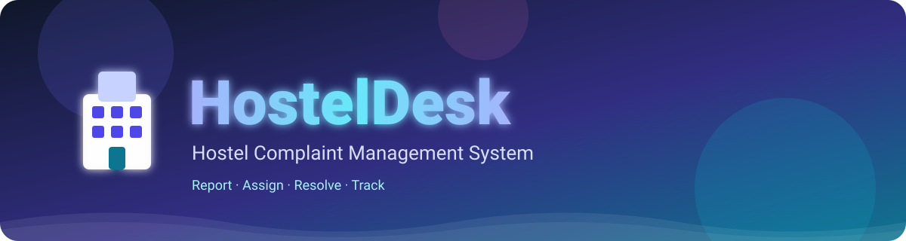
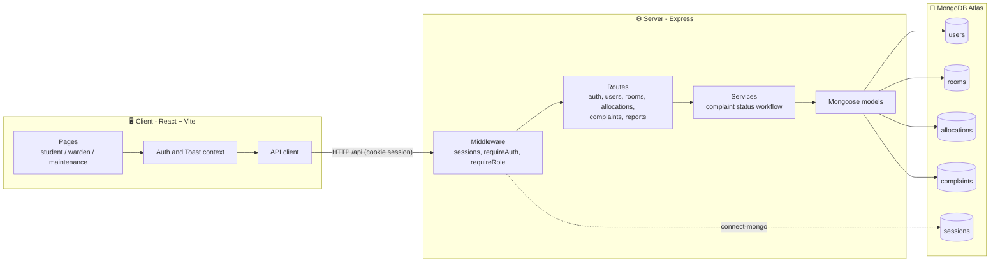
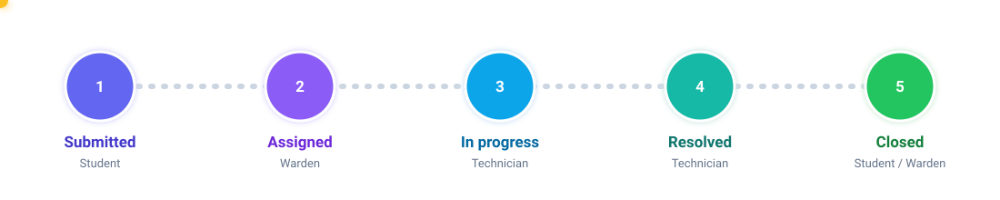
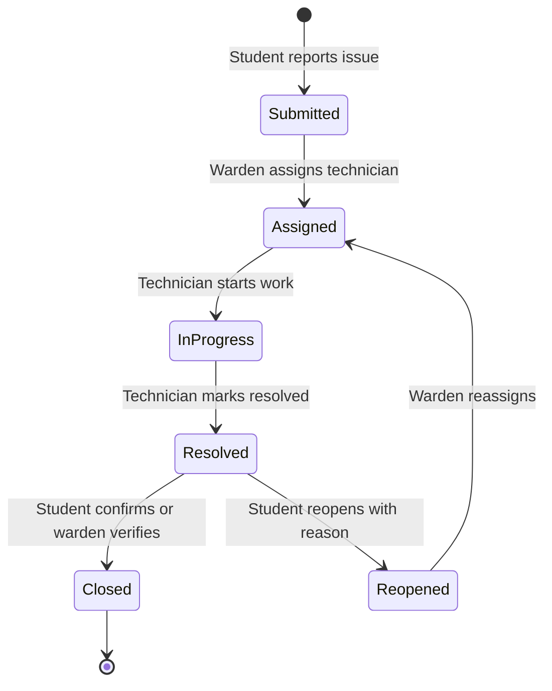
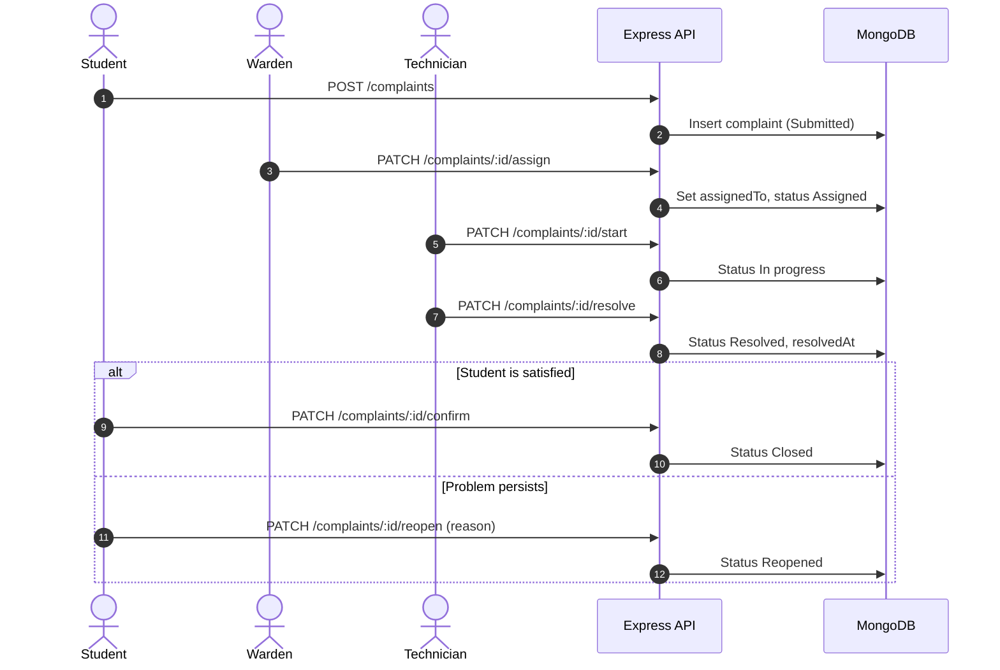
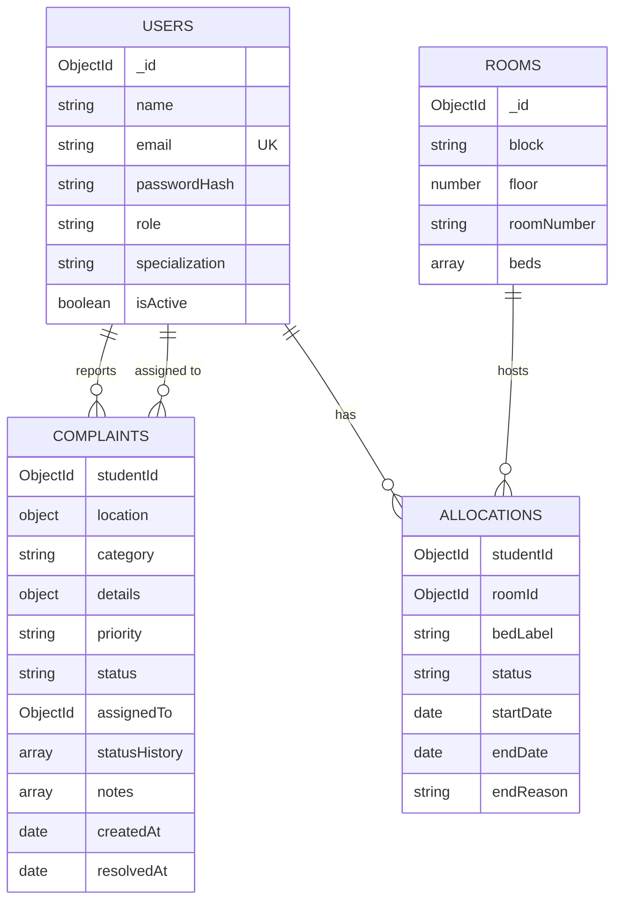

<div align="center">



<br/>

**A full-stack web app where students report hostel issues, wardens manage rooms and assign work, and technicians update the progress of their jobs. Every complaint has an owner, a status and a full history.**

<br/>

[](https://react.dev/)
[](https://vitejs.dev/)
[](https://www.typescriptlang.org/)
[](https://tailwindcss.com/)
[](https://www.framer.com/motion/)
[](https://recharts.org/)

[](https://nodejs.org/)
[](https://expressjs.com/)
[](https://www.mongodb.com/atlas)
[](https://mongoosejs.com/)

[Features](#-features) · [Tech Stack](#-tech-stack) · [Architecture](#-architecture) · [Quick Start](#-quick-start) · [Demo Guide](#-suggested-demo) · [API](#-api-reference) · [Troubleshooting](#-troubleshooting)

</div>


## 📖 Overview

**HostelDesk** replaces paper registers and WhatsApp messages with a single, accountable workflow for hostel maintenance.

- 🎓 **Students** raise a complaint for their room or a shared area and follow it until it is fixed.
- 🧑‍💼 **Wardens** manage rooms and beds, allocate and transfer students, set priorities and assign the right technician.
- 🔧 **Technicians** see only the jobs assigned to them, start work, add repair notes and mark jobs resolved.

Every status change is recorded with **who** did it, **in which role** and **when**, so nothing gets lost or disputed.


## ✨ Features

| | Feature | Details |
|---|---|---|
| 🔐 | **Role-based access** | Student, Warden and Maintenance roles. Every rule is enforced by the API (role checks plus record ownership), not just hidden in the UI. |
| 📝 | **Smart complaint forms** | Category-specific details (for example Wi-Fi network name), stored in a flexible `details` field. |
| 🎯 | **Specialty-aware assignment** | The matching technician (plumbing, electrical, carpentry, IT) is preselected. If none exists, the warden is told which specialty is missing. |
| 🔁 | **Reopen flow** | Students can reopen a resolved complaint with a reason, which sends it back to the warden's *Needs assignment* tab. |
| 🕓 | **Full audit history** | `statusHistory` records actor, role, timestamp and optional note for every change. |
| 🛏️ | **Rooms and beds** | Allocate, transfer and check out students. Old complaints keep the room they were reported from. |
| 📊 | **Analytics** | Aggregation reports for recurring problems, resolution times and occupancy, shown with Recharts. |
| ⚡ | **Concurrency safe** | Optimistic concurrency stops two people overwriting the same complaint. |
| 🔄 | **Transactional transfers** | Room transfers run in a MongoDB transaction, so a failure never leaves a student without a bed. |
| 🎨 | **Polished UI** | Tailwind CSS with Framer Motion animations and one-click demo logins. |


## 🧰 Tech Stack

| Layer | Technology | Purpose |
|---|---|---|
| **Frontend** | React 18, Vite, TypeScript | Fast, type-safe single-page app |
| **Styling and motion** | Tailwind CSS, Framer Motion | Responsive design and smooth transitions |
| **Charts** | Recharts | Reports and dashboard visuals |
| **Backend API** | Node.js, Express 4 | REST API, middleware, static hosting in production |
| **Database** | MongoDB Atlas, Mongoose 8 | Documents, indexes, aggregations, transactions |
| **Auth** | express-session, connect-mongo, bcrypt | Cookie sessions stored in MongoDB with hashed passwords |


## 🏗️ Architecture



### Complaint lifecycle

<div align="center">

</div>



### Who talks to whom



### Data model




## 🔑 Roles and Permissions

| Role | Can do |
|---|---|
| 🎓 **Student** | View current room, roommates and room history. Submit complaints for their room or a shared area. Track only their own complaints. Confirm a repair or reopen with a reason. |
| 🧑‍💼 **Warden** | Manage rooms and beds. Allocate, transfer and check out students. Review all complaints, set priorities, assign or reassign technicians, close verified complaints, manage staff accounts and view reports. |
| 🔧 **Maintenance** | See only jobs assigned to them. Start work, add repair notes and mark resolved. |


## 🚀 Quick Start

### 1. Prerequisites

- **Node.js 18.18 or newer** (Node 20 LTS recommended). Check with `node -v`
- A free **[MongoDB Atlas](https://cloud.mongodb.com)** account

### 2. Clone the repository

```bash
git clone https://github.com/LoganthP/HostelDesk.git
cd HostelDesk
```

### 3. Set up MongoDB Atlas (about 5 minutes)

1. Create a free **M0 cluster** at [cloud.mongodb.com](https://cloud.mongodb.com).
2. **Database Access** → *Add New Database User* → choose a user name and password. Avoid `@ : / ?` in the password, or URL-encode them.
3. **Network Access** → *Add IP Address* → *Add Current IP Address* (or `0.0.0.0/0` while testing).
4. **Connect** → *Drivers* → copy the connection string:

   ```
   mongodb+srv://<user>:<password>@cluster0.xxxxx.mongodb.net/?retryWrites=true&w=majority
   ```

> The app creates the database (`hostel_cms`), collections and indexes by itself.

### 4. Configure the backend

```bash
cd server
cp .env.example .env        # Windows (PowerShell): copy .env.example .env
```

Edit `server/.env`:

```env
MONGODB_URI=mongodb+srv://<user>:<password>@cluster0.xxxxx.mongodb.net/?retryWrites=true&w=majority
DB_NAME=hostel_cms
SESSION_SECRET=any-long-random-string
PORT=5000
NODE_ENV=development
COOKIE_SECURE=false
```

### 5. Install, seed and run

From the **project root**:

```bash
npm run install:all     # installs root, server and client packages
npm run seed            # loads demo rooms, users and complaints (resets the database!)
npm run dev             # starts API on :5000 and React on :5173 together
```

Open **http://localhost:5173** 🎉

> **Prefer two terminals?** Run `npm run dev` inside `server/` and `npm run dev` inside `client/`.

### Available scripts

| Command | What it does |
|---|---|
| `npm run install:all` | Installs root, server and client dependencies |
| `npm run seed` | Resets and fills the database with demo data |
| `npm run dev` | Runs API (`:5000`) and React (`:5173`) together |
| `npm run build` | Builds the client into `client/dist` |
| `npm start` | Starts the production server |
| `npm run test:api --prefix server` | Runs the 34-check API smoke test |


## 👤 Demo Accounts

**Password for all accounts:** `HostelDesk#Demo26`

> The password is deliberately unusual. Common passwords like `password123` make Chrome show a "password found in a data breach" warning in the middle of a demo.

| Role | Email |
|---|---|
| 🧑‍💼 Warden | `warden@hostel.edu` |
| 🔧 Maintenance (plumbing) | `ravi@hostel.edu` |
| 🔧 Maintenance (electrical) | `suresh@hostel.edu` |
| 🔧 Maintenance (carpentry) | `anil@hostel.edu` |
| 🔧 Maintenance (IT support / Wi-Fi) | `it@hostel.edu` |
| 🎓 Student in Room A101 | `arjun@student.edu` |
| 🎓 Student in Room A101 (has a resolved repair to confirm) | `kiran@student.edu` |
| 🎓 Student in Room B101 | `priya@student.edu` |
| 🎓 Student without a room | `rahul@student.edu` |

The login page has **one-click demo buttons** for Student, Warden, Plumber, Electrician, IT support and Carpenter. The plumber starts with an active job (*Shower drain is clogged*) waiting to be started, and the pest-control complaint shows what happens when no specialist exists.


## 🎬 Suggested Demo

**One Wi-Fi repair across all three roles.** Use two browser windows (one normal, one private) so you can switch roles quickly.

| Step | Role | Action |
|:---:|---|---|
| 1 | 🎓 **Student** (`priya@student.edu` or a newly registered student) | *Report an issue* → **Wi-Fi** → fill the network name → *Submit complaint*. It appears under *Awaiting assignment*. |
| 2 | 🧑‍💼 **Warden** | *Complaints* → *Needs assignment* → open it. **Farhan Ali (IT support / Wi-Fi)** is preselected because his specialty matches. Set priority → *Assign technician*. |
| 3 | 🔧 **IT support** (`it@hostel.edu`) | *Up next* → *Start work* → add a progress note → write a repair note → *Mark as resolved*. |
| 4 | 🎓 **Student** | The overview shows *Check these repairs* → open it → *Confirm repair* (or *Reopen* with a reason, which sends it back to the warden's *Needs assignment*). |
| 5 | 🕓 **Anyone** | Open the complaint's **History** to see who changed each status, in which role, and when. |

<details>
<summary><b>🛏️ Bonus: show room allocation</b></summary>

<br/>

**Warden** → *Rooms & beds* → click a free bed → allocate *Rahul Verma* → *Students* → *Transfer* him. The old bed becomes free, his earlier complaints keep the old room, and *History* shows both allocations.

</details>

<details>
<summary><b>🧩 Bonus: a category with no specialist</b></summary>

<br/>

If a category has no specialist (for example the seeded pest-control complaint), the complaint page says which specialty is missing, nothing is preselected, and the complaint stays in *Needs assignment* until the warden chooses someone or adds a specialist under *Staff*.

</details>


## 🏭 Production Build (single origin)

```bash
npm run build                      # builds client/dist
cd server && npm start             # Express serves the API and the React app on :5000
```

Open **http://localhost:5000**.

If you deploy behind HTTPS, set `NODE_ENV=production` and `COOKIE_SECURE=true`.


## 🔄 Complaint Workflow Rules

- `Submitted → Assigned → In progress → Resolved → Closed`
- **Reopen** (student, from Resolved, reason required) → `Reopened` → warden reassigns → `Assigned`.
- **Close** happens when the student confirms, or the warden verifies.
- Every change is recorded in `statusHistory` with who, which role, when and an optional note.
- Documents use **optimistic concurrency**, so two people editing the same complaint at once get a clear "refresh and try again" message instead of overwriting each other.

## 🗄️ Database Design

| Collection | Key fields | Notes |
|---|---|---|
| `users` | name, email (unique), passwordHash, role, specialization, isActive | One collection for all three roles. |
| `rooms` | block, floor, roomNumber, beds[{label}] | Beds embedded; unique `(block, roomNumber)`. |
| `allocations` | studentId, roomId, bedLabel, status, startDate, endDate, endReason | Full history kept. **Partial unique indexes**: one active allocation per student, one per `(roomId, bedLabel)`. |
| `complaints` | studentId, location (snapshot), category, details, priority, status, assignedTo, statusHistory[], notes[], createdAt, resolvedAt | Location is stored as reported, so it stays correct after the student moves. |
| `sessions` | managed by connect-mongo | Login sessions, expire after 7 days. |

**Transfers** run inside a MongoDB transaction (Atlas clusters support this), so a failed move leaves the student's original allocation intact. On a local standalone MongoDB without transactions, the API falls back to a compensating rollback.

### 📊 Aggregation reports (`/api/reports/...`)

| Endpoint | What it shows |
|---|---|
| `by-category-block` | Complaints grouped by hostel block and category (recurring problems) |
| `resolution-time` | Average, fastest and slowest hours from `createdAt` to `resolvedAt`, per category |
| `occupancy` | Bed counts per block compared with active allocations (`$lookup` into `allocations`) |
| `summary` | Dashboard counters |


## 📡 API Reference

All routes live under `/api`. Responses are JSON; errors look like `{ "message": "..." }`.

| Method | Route | Who |
|---|---|---|
| `POST` | `/auth/register` · `/auth/login` · `/auth/logout` | public |
| `GET` | `/auth/me` | signed in |
| `GET` `POST` `PATCH` | `/users` · `/users/technicians` · `/users/:id` | warden |
| `GET` | `/rooms/blocks` | signed in |
| `GET` `POST` `PATCH` `DELETE` | `/rooms` · `/rooms/available-beds` · `/rooms/:id` | warden |
| `GET` | `/allocations/me` | student |
| `GET` `POST` | `/allocations` · `/allocations/student/:id` · `/allocations/transfer` · `/allocations/checkout` | warden |
| `GET` | `/complaints` (filters: `status`, `category`, `priority`, `block`, `q`, `assignedTo`) · `/complaints/:id` | role-scoped |
| `POST` | `/complaints` | student |
| `PATCH` | `/complaints/:id/assign` · `/complaints/:id/close` | warden |
| `PATCH` | `/complaints/:id/start` · `/complaints/:id/resolve` | assigned technician |
| `POST` | `/complaints/:id/notes` | warden or assigned technician |
| `PATCH` | `/complaints/:id/confirm` · `/complaints/:id/reopen` | owning student |
| `GET` | `/reports/summary` · `/reports/by-category-block` · `/reports/resolution-time` · `/reports/occupancy` | warden |
| `GET` | `/health` | public |


## 📁 Project Structure

```
hostel-complaint-management-system/
├── package.json              # root scripts: install:all, dev, seed, build, start
├── server/
│   ├── .env.example
│   └── src/
│       ├── server.js         # connects to Atlas, builds indexes, starts Express
│       ├── app.js            # middleware, sessions, routes, serves client/dist
│       ├── seed.js           # demo data
│       ├── config/           # env loading + DB connection
│       ├── models/           # User, Room, Allocation, Complaint (Mongoose)
│       ├── routes/           # auth, users, rooms, allocations, complaints, reports
│       ├── services/         # complaint status workflow
│       ├── middleware/       # requireAuth / requireRole, error handler
│       └── utils/            # HTTP helpers, transaction helper
└── client/
    ├── vite.config.ts        # proxies /api → http://localhost:5000
    └── src/
        ├── lib/              # API client, types, constants, formatters
        ├── context/          # auth + toast providers
        ├── components/       # layout, UI kit, modals, timeline
        └── pages/            # student/, warden/, maintenance/ + shared pages
```


## 🧪 Testing

- **API smoke test (34 checks):** with the API running on a freshly seeded database, run:

  ```bash
  npm run test:api --prefix server
  ```

- **Full manual QA:** [`docs/QA_PROMPT.md`](docs/QA_PROMPT.md) is a ready-made prompt and checklist covering every button and the client–server connection.
- **How MongoDB is used, with file references:** [`docs/MONGODB.md`](docs/MONGODB.md).

### Quick behaviour checklist

- [ ] **Duplicate bed allocation:** allocate two students to the same bed → second request gets `409 That bed is already occupied.`
- [ ] **Unauthorized complaint access:** open another student's complaint URL → `403`. A technician opening a job not assigned to them → `403`.
- [ ] **Reopening:** resolve a complaint, reopen it as the student → it returns to the warden's *Needs assignment* tab and the reopen reason appears in the history.

> 💡 You can inspect the collections in **MongoDB Compass** with the same connection string.


## 🛠️ Troubleshooting

| Problem | Fix |
|---|---|
| `Could not connect to MongoDB` / timeout | Add your IP in Atlas → Network Access. Check user name and password. URL-encode special characters (`@` → `%40`). |
| `Missing environment variable(s)` | Create `server/.env` from `.env.example`. |
| Frontend shows "Can't reach the server" | Make sure the API is running on port 5000 (`npm run dev` from the root starts both). |
| `Port 5000 is already in use` | Change `PORT` in `server/.env` **and** the proxy target in `client/vite.config.ts`. On macOS, AirPlay Receiver uses port 5000, so turn it off or use 5050. |
| Logged out after every refresh in production over plain HTTP | Keep `COOKIE_SECURE=false` unless you serve over HTTPS. |
| Want to start over | `npm run seed` resets all data. |


## 🤝 Contributing

Contributions, issues and feature requests are welcome.

1. Fork the repository
2. Create a feature branch: `git checkout -b feature/amazing-feature`
3. Commit your changes: `git commit -m "Add amazing feature"`
4. Push the branch: `git push origin feature/amazing-feature`
5. Open a Pull Request

## 👨‍💻 Author

**Loganth P**

[](https://github.com/LoganthP)
[](https://www.linkedin.com/in/loganth-p-158667280/)

<div align="center">

<br/>

⭐ **If HostelDesk helped you, consider giving it a star!** ⭐

<sub>Built with React, Express and MongoDB Atlas</sub>

</div>
